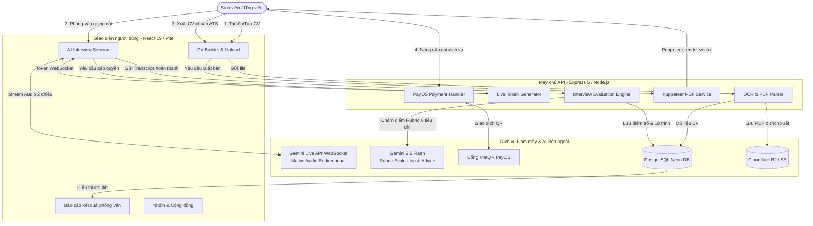

# BÁO CÁO PHÂN TÍCH TÍNH NĂNG KỸ THUẬT VÀ ĐẶC TÍNH SẢN PHẨM MVP
**Dự án:** JobReady AI – Nền tảng AI hỗ trợ sinh viên sẵn sàng cho thị trường lao động  
**Tài liệu chuẩn bị:** Thuyết trình & Bảo vệ đề tài MVP trước Hội đồng Giám khảo  

---

## A. TỔNG QUAN SẢN PHẨM

**JobReady AI** là nền tảng công nghệ toàn diện giải quyết bài toán thiếu hụt kỹ năng viết hồ sơ ứng tuyển và sự thiếu tự tin, thiếu kinh nghiệm thực chiến trong phỏng vấn tuyển dụng của sinh viên đại học Việt Nam. Sản phẩm cung cấp giải pháp khép kín giúp sinh viên từ việc kiến tạo một bản CV chuẩn ATS chuyên nghiệp đến việc luyện tập phỏng vấn đàm thoại hai chiều theo thời gian thực với AI mô phỏng nhà tuyển dụng thực tế, qua đó rút ngắn khoảng cách giữa môi trường học đường và tiêu chuẩn khắt khe của doanh nghiệp.

---

## B. CÁC TÍNH NĂNG CỐT LÕI (CORE FEATURES)

### 1. Phỏng vấn thử nghiệm AI đàm thoại thời gian thực (Real-time Voice AI Mock Interview)

- **Vấn đề của sinh viên giải quyết:** Sinh viên thường bị tâm lý sợ hãi, lúng túng khi phỏng vấn trực tiếp với nhà tuyển dụng do thiếu môi trường thực hành và không được cọ xát với các câu hỏi tình huống thực tế.
- **Mô tả tính năng:** Sinh viên được trò chuyện trực tiếp hai chiều bằng giọng nói với AI đóng vai người phỏng vấn. Bạn có thể chọn phong cách nhà tuyển dụng mong muốn (thân thiện, nghiêm khắc hoặc chuyên sâu kỹ thuật) và trả lời các câu hỏi chuyên ngành sát với CV đã tải lên.
- **Luồng sử dụng:**
  1. Vào mục **Phỏng vấn AI** (`/interview/setup`), chọn vị trí ứng tuyển mong muốn và chọn bản CV dùng để đối chiếu.
  2. Chọn **Người phỏng vấn (Persona)**: Chị Linh (Thân thiện), Chị Hương (Nghiêm khắc, áp lực cao), hoặc Anh Minh (Tech Lead chuyên môn sâu).
  3. Bật Microphone và bắt đầu phiên phỏng vấn thời gian thực (`/interview/session`).
  4. Trả lời các câu hỏi bằng giọng nói; AI lắng nghe, phản hồi tức thì và ghi nhận transcript đàm thoại.
  5. Kết thúc buổi phỏng vấn bằng nút cúp máy hoặc khi hoàn thành các câu hỏi để chuyển sang màn hình nhận kết quả.
- **Cách hoạt động về mặt kỹ thuật:** Client xin cấp token tạm thời từ server (`/api/interview/live-token`) và thiết lập kết nối WebSocket trực tiếp đến Google Gemini Live Multimodal API (`models/gemini-2.5-flash-native-audio-latest`). Dòng âm thanh (PCM audio stream) từ trình duyệt được gửi liên tục qua WebSocket và nhận lại âm thanh phản hồi cùng transcript phụ đề theo thời gian thực với độ trễ cực thấp (<1s).
- **File/thư mục liên quan trong code:**
  - Frontend: [`src/pages/User/InterviewSetupPage.tsx`](file:///d:/K%C3%AC%20h%E1%BB%8Dc/ss8/EXE201/jobredy-ai-homepage/src/pages/User/InterviewSetupPage.tsx), [`src/pages/User/InterviewPersonaSelectPage.tsx`](file:///d:/K%C3%AC%20h%E1%BB%8Dc/ss8/EXE201/jobredy-ai-homepage/src/pages/User/InterviewPersonaSelectPage.tsx), [`src/pages/User/InterviewSessionPage.tsx`](file:///d:/K%C3%AC%20h%E1%BB%8Dc/ss8/EXE201/jobredy-ai-homepage/src/pages/User/InterviewSessionPage.tsx), [`src/hooks/useGeminiLiveV2.ts`](file:///d:/K%C3%AC%20h%E1%BB%8Dc/ss8/EXE201/jobredy-ai-homepage/src/hooks/useGeminiLiveV2.ts)
  - Ngân hàng câu hỏi: [`src/data/interview-questions/`](file:///d:/K%C3%AC%20h%E1%BB%8Dc/ss8/EXE201/jobredy-ai-homepage/src/data/interview-questions) (Web/Mobile, Data/AI, QA, Security, Marketing, Communications...)
  - Backend: [`server/routes/live-token.js`](file:///d:/K%C3%AC%20h%E1%BB%8Dc/ss8/EXE201/jobredy-ai-homepage/server/routes/live-token.js), [`server/routes/interview.js`](file:///d:/K%C3%AC%20h%E1%BB%8Dc/ss8/EXE201/jobredy-ai-homepage/server/routes/interview.js)
- **Trạng thái:** **Hoàn thiện** (Chạy trực tiếp qua WebSocket đàm thoại hai chiều, có bộ quản lý quota theo tuần/tháng).
- **Điểm nổi bật để nhấn mạnh khi thuyết trình:** Công nghệ đàm thoại trực tiếp Native Audio độ trễ thấp giúp sinh viên trải nghiệm áp lực phòng vấn chân thật như nói chuyện với người thật, không phải dạng trả lời văn bản giả lập.

---

### 2. Báo cáo đánh giá đa chiều & Lộ trình cải thiện phỏng vấn (AI Interview Evaluation & Action Plan)

- **Vấn đề của sinh viên giải quyết:** Sinh viên sau khi phỏng vấn thường bị "trượt trong im lặng" mà không biết mình sai ở đâu, nói dở điểm nào và cần cải thiện kỹ năng gì để đậu lần sau.
- **Mô tả tính năng:** Ngay sau khi kết thúc phỏng vấn, hệ thống tự động xuất bản một bản báo cáo phân tích toàn diện. Báo cáo chỉ rõ điểm số từng tiêu chí, đánh giá diễn biến theo 6 chặng phỏng vấn, phân tích nhịp giọng nói, chỉ ra điểm mạnh/yếu và đưa ra lộ trình 3 bước hành động cụ thể.
- **Luồng sử dụng:**
  1. Sau phiên phỏng vấn, hệ thống tự động chuyển hướng đến trang kết quả (`/interview/result/:sessionId`).
  2. Người dùng xem tổng quan: Điểm tổng, mức độ xếp loại (Xuất sắc / Đạt / Cần cải thiện) và chỉ số giọng nói (âm lượng, số lần ngập ngừng, độ tự tin).
  3. Kiểm tra chi tiết 6 tiêu chí rubric (Nội dung, Kiến thức chuyên môn, Giải quyết vấn đề, Mức độ phù hợp vị trí, Kỹ năng mềm, Giao tiếp).
  4. Đọc đánh giá theo 6 chặng phỏng vấn và xem phần "Gợi ý câu trả lời mẫu tốt hơn" (Sample Improvements).
  5. Nhận "Lộ trình hành động" (Action Plan 3 bước: Làm gì, Tại sao, Làm như thế nào) và có thể xem lại lịch sử tại `/interview/history`.
- **Cách hoạt động về mặt kỹ thuật:** Server tổng hợp transcript đầy đủ, CV ứng viên và danh sách câu hỏi đã hỏi gửi vào service [`InterviewEvaluationService.js`](file:///d:/K%C3%AC%20h%E1%BB%8Dc/ss8/EXE201/jobredy-ai-homepage/server/service/InterviewEvaluationService.js). Service gọi model `gemini-2.5-flash` với cấu hình ép kiểu JSON Schema để chống ảo giác (hallucination) và đối chiếu với bộ Rubric chấm điểm khắt khe. Kết quả được lưu vào bảng `interview_sessions` trong PostgreSQL.
- **File/thư mục liên quan trong code:**
  - Frontend: [`src/pages/User/InterviewResultPage.tsx`](file:///d:/K%C3%AC%20h%E1%BB%8Dc/ss8/EXE201/jobredy-ai-homepage/src/pages/User/InterviewResultPage.tsx), [`src/pages/User/InterviewHistoryPage.tsx`](file:///d:/K%C3%AC%20h%E1%BB%8Dc/ss8/EXE201/jobredy-ai-homepage/src/pages/User/InterviewHistoryPage.tsx)
  - Backend: [`server/service/InterviewEvaluationService.js`](file:///d:/K%C3%AC%20h%E1%BB%8Dc/ss8/EXE201/jobredy-ai-homepage/server/service/InterviewEvaluationService.js), [`server/config/scoring.js`](file:///d:/K%C3%AC%20h%E1%BB%8Dc/ss8/EXE201/jobredy-ai-homepage/server/config/scoring.js), [`server/service/questionBankHelper.js`](file:///d:/K%C3%AC%20h%E1%BB%8Dc/ss8/EXE201/jobredy-ai-homepage/server/service/questionBankHelper.js)
- **Trạng thái:** **Hoàn thiện** (Có cơ chế chống suy đoán, tự động đối chiếu câu hỏi thực tế trong transcript, hỗ trợ chấm lại - re-evaluate nếu lỗi mạng).
- **Điểm nổi bật để nhấn mạnh khi thuyết trình:** Báo cáo không nhận xét chung chung mà trích xuất trực tiếp bằng chứng từ câu trả lời của sinh viên và đề xuất câu trả lời nâng cấp cụ thể để sinh viên tiến bộ ngay lập tức.

---

### 3. Tạo & Tối ưu CV thông minh chuẩn ATS với Trợ lý AI (Smart CV Builder & AI Advisor)

- **Vấn đề của sinh viên giải quyết:** Sinh viên năm cuối chưa biết cách cấu trúc CV chuyên nghiệp, thiếu từ khóa ngành nghề, dùng từ ngữ ngô nghê và thường bị hệ thống lọc hồ sơ tự động (ATS) loại ngay từ vòng gửi xe.
- **Mô tả tính năng:** Sinh viên có thể tạo CV mới từ hơn 20 mẫu thiết kế chuẩn ATS hoặc tải lên CV cũ (PDF/ảnh) để hệ thống tự động trích xuất thông tin. Trong lúc soạn thảo, Trợ lý AI (AI Advisor) tích hợp sẵn trong trình chỉnh sửa sẽ hướng dẫn viết lại các mô tả công việc, bổ sung kỹ năng và tối ưu hóa từ khóa theo vị trí tuyển dụng.
- **Luồng sử dụng:**
  1. Người dùng vào trang quản lý CV (`/cv`), chọn **Tạo CV mới** (`/cv/create`) hoặc **Tải lên CV** (hỗ trợ PDF/JPG/PNG).
  2. Nếu tải lên CV cũ, hệ thống tự động đọc và bóc tách dữ liệu vào các mục tương ứng.
  3. Chọn mẫu thiết kế CV phù hợp (Harvard, Minimal, Modern Split, Executive Banner...) và tùy chỉnh màu sắc.
  4. Mở cửa sổ chat với **Trợ lý AI** ở góc màn hình để yêu cầu AI viết lại đoạn mô tả kinh nghiệm, gợi ý kỹ năng cần thiết hoặc dịch thuật.
  5. Xem trước trực tiếp (`/cv/preview`) và tải file PDF chất lượng cao về máy.
- **Cách hoạt động về mặt kỹ thuật:**
  - Bóc tách CV tải lên: Sử dụng `unpdf` / `pdf2json` đối với PDF văn bản; sử dụng kết hợp Gemini Vision API và fallback sang thư viện OCR `tesseract.js` (traineddata `vie` + `eng`) đối với file ảnh/scan.
  - Trợ lý AI: Route `/api/ai/cv-advisor` sử dụng Gemini API với hệ thống quản lý xoay vòng API Key (5 keys) và cơ chế cooldown tự động.
  - Xuất bản PDF: Route `/api/cv-export` sử dụng Puppeteer chạy headless Chrome, truy cập vào trang kết xuất chuẩn in ấn `/cv-print` để in vector PDF chất lượng cao, lưu trữ đồng bộ lên Cloudflare R2 / AWS S3.
- **File/thư mục liên quan trong code:**
  - Frontend: [`src/pages/User/CVBuilderPage.tsx`](file:///d:/K%C3%AC%20h%E1%BB%8Dc/ss8/EXE201/jobredy-ai-homepage/src/pages/User/CVBuilderPage.tsx), [`src/pages/User/CVListPage.tsx`](file:///d:/K%C3%AC%20h%E1%BB%8Dc/ss8/EXE201/jobredy-ai-homepage/src/pages/User/CVListPage.tsx), [`src/pages/User/DraftCVPage.tsx`](file:///d:/K%C3%AC%20h%E1%BB%8Dc/ss8/EXE201/jobredy-ai-homepage/src/pages/User/DraftCVPage.tsx), [`src/pages/CVPrintPage.tsx`](file:///d:/K%C3%AC%20h%E1%BB%8Dc/ss8/EXE201/jobredy-ai-homepage/src/pages/CVPrintPage.tsx)
  - Backend: [`server/routes/cv.js`](file:///d:/K%C3%AC%20h%E1%BB%8Dc/ss8/EXE201/jobredy-ai-homepage/server/routes/cv.js), [`server/routes/upload.js`](file:///d:/K%C3%AC%20h%E1%BB%8Dc/ss8/EXE201/jobredy-ai-homepage/server/routes/upload.js), [`server/routes/ai-cv-advisor.js`](file:///d:/K%C3%AC%20h%E1%BB%8Dc/ss8/EXE201/jobredy-ai-homepage/server/routes/ai-cv-advisor.js), [`server/service/PDFExportService.js`](file:///d:/K%C3%AC%20h%E1%BB%8Dc/ss8/EXE201/jobredy-ai-homepage/server/service/PDFExportService.js)
- **Trạng thái:** **Hoàn thiện** (Bóc tách thông tin tốt, xuất file PDF chuẩn xác bằng Puppeteer).
- **Điểm nổi bật để nhấn mạnh khi thuyết trình:** Khả năng bóc tách CV từ cả hình ảnh và PDF kết hợp AI tương tác trực tiếp giúp sinh viên biến một bản nháp đơn sơ thành hồ sơ đạt tiêu chuẩn doanh nghiệp chỉ trong vài phút.

---

### 4. Cộng đồng học tập nghề nghiệp & Nhóm luyện tập chuyên sâu (Career Community & Study Groups)

- **Vấn đề của sinh viên giải quyết:** Sinh viên thường cảm thấy đơn độc trong quá trình tìm việc, thiếu kênh trao đổi kinh nghiệm phỏng vấn thực tế và thiếu mạng lưới bạn bè cùng chí hướng để luyện tập nhóm.
- **Mô tả tính năng:** Sinh viên có thể tạo hoặc tham gia các nhóm học tập theo chuyên ngành/vị trí ứng tuyển. Các thành viên có thể chia sẻ kinh nghiệm phỏng vấn, đăng bài thảo luận, tương tác cảm xúc, mời bạn bè bằng mã QR và có cơ chế kiểm duyệt nội dung an toàn.
- **Luồng sử dụng:**
  1. Người dùng vào mục **Nhóm** (`/groups`), duyệt danh sách nhóm hoặc bấm **Tạo nhóm mới**.
  2. Mời bạn bè tham gia nhóm nhanh chóng bằng cách quét mã QR động hoặc chia sẻ link mời (`/groups/invite`).
  3. Đăng bài viết chia sẻ kinh nghiệm (`/groups/create-post`) theo mẫu bài viết có sẵn.
  4. Tương tác với bài viết của thành viên: Thả 6 loại cảm xúc (Thích, Yêu thích, Haha, Wow, Buồn, Phẫn nộ) và viết bình luận đa tầng.
  5. Quản trị nhóm: Trưởng nhóm có thể phân quyền (Phó nhóm, Quản trị viên bài viết), xử lý vi phạm hoặc chuyển giao quyền Trưởng nhóm.
- **Cách hoạt động về mặt kỹ thuật:** Backend tại [`server/routes/groups.js`](file:///d:/K%C3%AC%20h%E1%BB%8Dc/ss8/EXE201/jobredy-ai-homepage/server/routes/groups.js) quản lý mô hình dữ liệu quan hệ phức tạp trong PostgreSQL (`groups`, `group_members`, `group_posts`, `group_post_likes`, `group_post_comments`, `group_invitations`, `group_violation_reports`). Tích hợp thư viện `qrcode.react` render mã QR tức thì và hệ thống kiểm duyệt báo cáo liên kết với vai trò Content Manager.
- **File/thư mục liên quan trong code:**
  - Frontend: [`src/pages/User/GroupsPage.tsx`](file:///d:/K%C3%AC%20h%E1%BB%8Dc/ss8/EXE201/jobredy-ai-homepage/src/pages/User/GroupsPage.tsx), [`src/pages/User/GroupDetailPage.tsx`](file:///d:/K%C3%AC%20h%E1%BB%8Dc/ss8/EXE201/jobredy-ai-homepage/src/pages/User/GroupDetailPage.tsx), [`src/pages/User/GroupInvitePage.tsx`](file:///d:/K%C3%AC%20h%E1%BB%8Dc/ss8/EXE201/jobredy-ai-homepage/src/pages/User/GroupInvitePage.tsx), [`src/pages/User/CreatePostPage.tsx`](file:///d:/K%C3%AC%20h%E1%BB%8Dc/ss8/EXE201/jobredy-ai-homepage/src/pages/User/CreatePostPage.tsx)
  - Backend: [`server/routes/groups.js`](file:///d:/K%C3%AC%20h%E1%BB%8Dc/ss8/EXE201/jobredy-ai-homepage/server/routes/groups.js), [`server/routes/friends.js`](file:///d:/K%C3%AC%20h%E1%BB%8Dc/ss8/EXE201/jobredy-ai-homepage/server/routes/friends.js)
- **Trạng thái:** **Hoàn thiện** (Bao gồm đầy đủ phân quyền 4 cấp độ, mã QR mời vào nhóm, chuyển giao quyền trưởng nhóm, hệ thống report & kháng cáo).
- **Điểm nổi bật để nhấn mạnh khi thuyết trình:** Xây dựng tính năng mạng xã hội thu nhỏ gắn liền với môi trường học tập, tạo hiệu ứng mạng lưới (network effect) giữ chân sinh viên trên nền tảng.

---

## C. CÁC TÍNH NĂNG PHỤ (SUPPORTING FEATURES)

1. **Trợ lý giải đáp & Hướng dẫn sử dụng 24/7 (AI Customer Support):** Widget chat bong bóng nổi luôn trực tuyến, tự động trả lời hướng dẫn quy trình phỏng vấn, tạo CV và các gói dịch vụ qua Gemini AI (`CustomerSupportBubble.tsx`).
2. **Cổng Cẩm nang nghề nghiệp & Tin tức tuyển dụng (Career Blog & Press):** Trang tin tức, bài viết định hướng nghề nghiệp, kỹ năng phỏng vấn phân loại theo chuyên mục (`BlogPage.tsx`, `server/routes/blog.js`).
3. **Thanh toán trực tuyến tự động qua VietQR (PayOS Integration):** Tích hợp cổng PayOS tạo mã QR thanh toán ngân hàng tự động, webhook kích hoạt gói dịch vụ tức thì và gửi hóa đơn email qua Resend (`PricingPage.tsx`, `server/routes/payment.js`).
4. **Hệ thống Ưu đãi, Khuyến mãi & Giới thiệu bạn bè (Promotions & Referral):** Banner khuyến mãi động, popup ưu đãi giảm giá cá nhân hóa khi hết hạn mức (Quota Exceeded Promo) và mã giới thiệu bạn bè (`PromotionalBanner.tsx`, `DiscountOfferPopup.tsx`).
5. **Nhắn tin trực tiếp & Quản lý bạn bè (Direct Messaging & Friends):** Gửi lời mời kết bạn, danh sách bạn bè online, nhắn tin riêng 1-1 giữa các ứng viên (`MessagesPage.tsx`, `server/routes/friends.js`).
6. **Hệ thống Đăng nhập & Xác thực bảo mật (Auth & Security):** Đăng nhập qua Email/Mật khẩu với OTP xác thực, hỗ trợ Google OAuth, Facebook Login, đồng bộ Clerk Auth và tự động đăng xuất khi không hoạt động (`IdleTimeoutProvider.tsx`).
7. **Hệ thống Quản trị & Điều phối đa vai trò (Admin & Content Manager Dashboard):** Phân quyền 3 cấp độ (`admin`, `content_manager`, `user`), xem doanh thu tài chính thời gian thực, quản lý người dùng, khóa tài khoản, chặn IP/Domain và chế độ bảo trì hệ thống toàn diện.
8. **Đa ngôn ngữ & Giao diện cá nhân hóa (i18n & Dark/Light Theme):** Chuyển đổi mượt mà Tiếng Việt / Tiếng Anh, giao diện sáng/tối tự động lưu cấu hình và Onboarding Tour hướng dẫn người dùng mới.

---

## D. TÓM TẮT KIẾN TRÚC KỸ THUẬT

### 1. Thành phần công nghệ
- **Frontend:** React 19, TypeScript, Vite 7, Tailwind CSS v4, Lucide React, Radix UI Primitives, i18next, Recharts, Framer Motion.
- **Backend:** Node.js (v18+) với Express 5, kiến trúc phân lớp hướng module (Routes, Services, Middlewares, Repositories).
- **Cơ sở dữ liệu:** PostgreSQL (Neon Serverless PostgreSQL), pooling kết nối qua thư viện `pg`, cache dữ liệu trong bộ nhớ với TTL tự hủy.
- **Dịch vụ AI:**
  - Google Gemini Live Multimodal API (`models/gemini-2.5-flash-native-audio-latest`) cho đàm thoại phỏng vấn trực tiếp hai chiều qua WebSocket.
  - Google Gemini 2.5 Flash (`gemini-2.5-flash`) cho chấm điểm phỏng vấn theo Rubric 6 tiêu chí và xuất định dạng JSON Schema.
  - Gemini Vision API & Tesseract.js OCR (tiếng Việt `vie` + tiếng Anh `eng`) cho nhận dạng văn bản CV từ ảnh/scan.
  - Gemini Pro / Flash cho AI CV Advisor và AI Support Chatbot.
- **Bảo mật & Hạ tầng:** Helmet (CSP nghiêm ngặt, HSTS, frameguard), Express-Rate-Limit, Cloudflare R2 / AWS S3 lưu trữ tệp, Puppeteer xuất PDF, PayOS xử lý cổng thanh toán ngân hàng, Resend gửi email giao dịch.

### 2. Sơ đồ luồng dữ liệu chính (Mermaid)

---

## E. ĐỀ XUẤT KỊCH BẢN DEMO (1 - 2 PHÚT)

**Mục tiêu:** Thuyết phục Ban Giám khảo thấy ngay tính khả thi kỹ thuật và giá trị vượt trội của sản phẩm thông qua 1 luồng trải nghiệm liền mạch:

1. **00:00 - 00:25 (Tạo & Tối ưu CV với AI):**
   - Mở màn hình **CV của tôi** (`/cv`), mở nhanh một bản CV đang tạo trong **CV Builder**.
   - Mở **Trợ lý AI** ở góc phải, gõ nhanh yêu cầu: *"Tôi ứng tuyển vị trí Frontend Developer, hãy tối ưu phần kỹ năng"*.
   - Cho giám khảo thấy AI tự động điền các kỹ năng chuyên môn vào CV và bấm **Xem trước PDF** để thấy mẫu thiết kế chuẩn ATS.

2. **00:25 - 01:15 (Phỏng vấn thực tế với AI Voice):**
   - Chuyển sang mục **Phỏng vấn AI** (`/interview/setup`), chọn vị trí *Frontend Developer*, chọn người phỏng vấn *Chị Hương (Nghiêm khắc)*.
   - Bắt đầu phiên phỏng vấn (`/interview/session`): AI cất tiếng hỏi ứng viên bằng giọng nói tự nhiên: *"Chào em, hãy giới thiệu ngắn gọn về kinh nghiệm làm việc với React của em?"*.
   - Người thuyết trình bật mic nói trực tiếp 1 câu ngắn: *"Em đã làm dự án thương mại điện tử bằng React và Tailwind CSS trong 6 tháng qua"*.
   - AI phản hồi đàm thoại tức thì và chuyển câu hỏi tiếp theo để chứng minh độ trễ thấp.

3. **01:15 - 01:45 (Báo cáo đánh giá & Lộ trình hành động):**
   - Bấm kết thúc phiên phỏng vấn để chuyển sang trang **Kết quả phỏng vấn** (`/interview/result`).
   - Lướt nhanh qua bảng điểm Rubric 6 tiêu chí, biểu đồ giọng nói, chỉ rõ điểm yếu và điểm nổi bật nhất: **Action Plan 3 bước** do AI lập ra để sinh viên cải thiện.

4. **01:45 - 02:00 (Cộng đồng & Kết bài):**
   - Mở nhanh trang **Nhóm cộng đồng** (`/groups`), chỉ vào mã QR mời nhóm và kết luận: JobReady AI là hệ sinh thái toàn diện đồng hành cùng sinh viên từ CV đến việc làm thành công.

---

## F. ĐIỂM CẦN LƯU Ý & CÂU HỎI TIỀM ẨN KHI BẢO VỆ

### 1. Điểm cần lưu ý về mặt kỹ thuật trong code:
- **Phỏng vấn AI chỉ dùng Âm thanh (Audio-only):** Hệ thống không bật camera/quay video khuôn mặt (đã được ghi chú rõ ràng trong prompt của hệ thống). Khi trình bày, nhấn mạnh đây là chủ đích thiết kế nhằm tối ưu hóa băng thông, giảm độ trễ đàm thoại và tập trung vào phản xạ ngôn từ/giọng điệu.
- **Tính năng So sánh CV (CV Comparison):** Được đề cập trong quy tắc gói cước của Bot CSKH nhưng trên giao diện người dùng hiện tại chưa có trang so sánh song song 2 CV độc lập. Nếu được hỏi, trả lời tính năng này đang trong lộ trình phát hành giai đoạn 2.
- **Phụ thuộc vào Gemini Live WebSocket:** Tính năng đàm thoại yêu cầu kết nối mạng ổn định và quyền microphone của trình duyệt. Cần chuẩn bị sẵn 1 phiên phỏng vấn đã hoàn thành trong lịch sử (`/interview/history`) để dự phòng nếu mạng tại hội trường thuyết trình chập chờn.

### 2. Các câu hỏi khó tiềm ẩn từ Ban Giám khảo & Gợi ý trả lời:

* **Câu hỏi 1: Làm sao đảm bảo AI không "ảo giác" (hallucination) và chấm điểm thiên vị hoặc sai lệch năng lực của sinh viên?**  
  *Gợi ý trả lời:* Hệ thống xây dựng cơ chế bảo đảm bằng code hai lớp trong `InterviewEvaluationService.js`. Lớp 1 là bộ Rubric chuẩn hóa 6 tiêu chí với quy định ngặt nghèo: nếu transcript không có bằng chứng thì bắt buộc trả về `score = null`, tuyệt đối không tự đoán mò. Lớp 2 là sử dụng chế độ JSON Schema bắt buộc của Gemini 2.5 Flash và đối chiếu chéo câu hỏi thực tế từ ngân hàng câu hỏi để loại trừ câu chưa được hỏi.

* **Câu hỏi 2: Tại sao chọn Gemini Live API mà không dùng mô hình Speech-to-Text (STT) rồi gửi vào ChatGPT rồi Text-to-Speech (TTS)?**  
  *Gợi ý trả lời:* Quy trình truyền thống STT -> LLM -> TTS tạo ra độ trễ cộng dồn từ 3-5 giây, làm mất tính phản xạ tự nhiên của một buổi phỏng vấn. JobReady AI sử dụng Gemini Live Multimodal Native Audio qua WebSocket hai chiều, mô hình xử lý trực tiếp âm thanh đầu vào và sinh âm thanh đầu ra, giúp giảm độ trễ xuống dưới 1 giây, mang lại trải nghiệm đàm thoại chân thực.

* **Câu hỏi 3: Chi phí gọi API AI cho mỗi lượt phỏng vấn và tạo CV có khả thi về mặt kinh tế không?**  
  *Gợi ý trả lời:* Hệ thống đã thiết lập cơ chế kiểm soát hạn mức (Quota system) phân tầng chặt chẽ: Tài khoản miễn phí chỉ được 2 lượt phỏng vấn/tuần; gói Pro và Ultra thanh toán qua cổng PayOS bù đắp chi phí vận hành. Ngoài ra, backend có hệ thống xoay vòng 5 API Keys và cơ chế cache kết quả phân tích CV (`cv_text_cache`), tránh việc gọi AI trùng lặp gây lãng phí chi phí.
